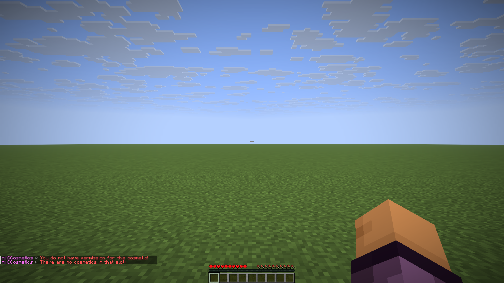
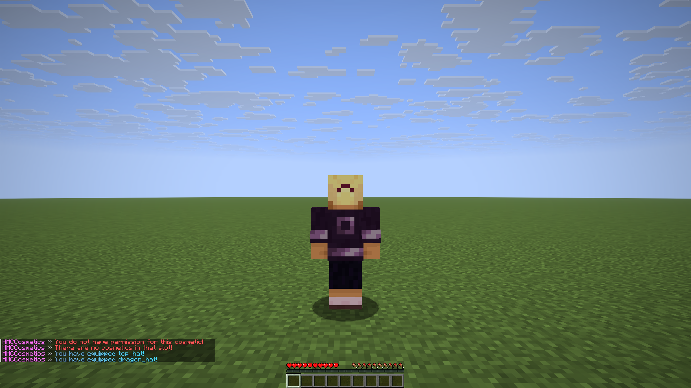
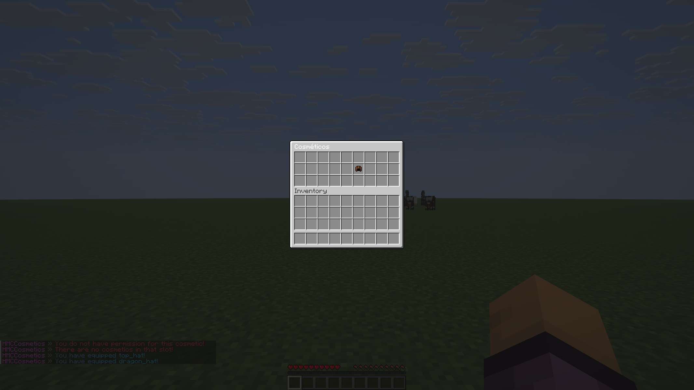
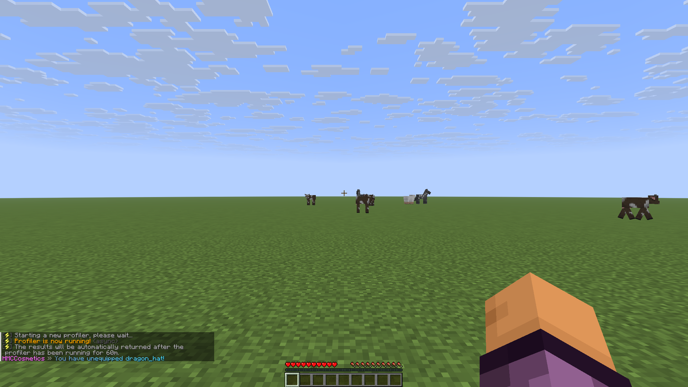

# Sistema: HMCCosmetics — PASSOU

Executado em 2026-11-23 01:37 UTC

## Pedido e o que foi feito

**Pedido:** não informado

**O que foi feito:**

- Comando /hmccosmetics: Base Cosmetic Command
- Permissão hmccosmetics.cmd.apply
- Permissão hmccosmetics.cmd.apply.other
- Permissão hmccosmetics.cmd.clearhiddenreasons
- Permissão hmccosmetics.cmd.clearhiddenreasons.other
- Permissão hmccosmetics.cmd.dataclear
- Permissão hmccosmetics.cmd.debug
- Permissão hmccosmetics.cmd.default
- Permissão hmccosmetics.cmd.disableall
- Permissão hmccosmetics.cmd.dye
- Permissão hmccosmetics.cmd.emote
- Permissão hmccosmetics.cmd.emote.other
- Permissão hmccosmetics.cmd.hiddenreasons
- Permissão hmccosmetics.cmd.hiddenreasons.other
- Permissão hmccosmetics.cmd.hide
- Permissão hmccosmetics.cmd.hide.other
- Permissão hmccosmetics.cmd.menu
- Permissão hmccosmetics.cmd.menu.other
- Permissão hmccosmetics.cmd.playemote
- Permissão hmccosmetics.cmd.playemote.other
- Permissão hmccosmetics.cmd.reload
- Permissão hmccosmetics.cmd.setwardrobesetting
- Permissão hmccosmetics.cmd.show
- Permissão hmccosmetics.cmd.show.other
- Permissão hmccosmetics.cmd.toggle
- Permissão hmccosmetics.cmd.toggle.other
- Permissão hmccosmetics.cmd.unapply
- Permissão hmccosmetics.cmd.unapply.other
- Permissão hmccosmetics.cmd.wardrobe
- Permissão hmccosmetics.cmd.wardrobe.other
- Permissão hmccosmetics.emote.shiftrun
- Permissão hmccosmetics.unapplydeath.bypass

## Compila e liga

- Build: ok
- Servidor liga: ok
- Cliente (bot): ok
- Log: limpo

## Sem permissao

| # | Passo | Status | Esperado | Visto | Tempo | Print |
|---|---|---|---|---|---|---|
| 1 | console tp @bot 0.5 -60 0.5 | ok | console: tp @bot 0.5 -60 0.5 | System chat: Teleported @bot to 0.500000, -60.000000, 0.500000 | 61 ms | — |
| 2 | sleep 1500 | ok | esperar 1500 ms | ok | 1.5 s | — |
| 3 | command cosmetic apply top_hat | ok | enviar /cosmetic apply top_hat | enviado | 106 ms | — |
| 4 | expectChat do not have permission | ok | chat com "do not have permission" | HMCCosmetics » You do not have permission for this cosmetic! | 65 ms | — |
| 5 | command cosmetic unapply HELMET | ok | enviar /cosmetic unapply HELMET | enviado | 117 ms | — |
| 6 | expectChat no cosmetics in that slot | ok | chat com "no cosmetics in that slot" | HMCCosmetics » There are no cosmetics in that slot! | 59 ms | — |
| 7 | screenshot 00-sem-permissao | ok | print da tela | 07-00-sem-permissao.png | 620 ms | [ver](07-00-sem-permissao.png) |

## Equipar

| # | Passo | Status | Esperado | Visto | Tempo | Print |
|---|---|---|---|---|---|---|
| 8 | op | ok | @bot vira operador | System chat: Made @bot a server operator | 53 ms | — |
| 9 | command cosmetic apply top_hat | ok | enviar /cosmetic apply top_hat | enviado | 186 ms | — |
| 10 | expectChat equipped top_hat | ok | chat com "equipped top_hat" | HMCCosmetics » You have equipped top_hat! | 57 ms | — |
| 11 | command cosmetic apply dragon_hat | ok | enviar /cosmetic apply dragon_hat | enviado | 113 ms | — |
| 12 | expectChat equipped dragon_hat | ok | chat com "equipped dragon_hat" | HMCCosmetics » You have equipped dragon_hat! | 60 ms | — |
| 13 | key F5 | ok | tecla F5 | pressionada | 58 ms | — |
| 14 | sleep 1200 | ok | esperar 1200 ms | ok | 1.2 s | — |
| 15 | screenshot 01-dragao-3a-pessoa | ok | print da tela | 15-01-dragao-3a-pessoa.png | 492 ms | [ver](15-01-dragao-3a-pessoa.png) |
| 16 | key F5 | ok | tecla F5 | pressionada | 54 ms | — |
| 17 | key F5 | ok | tecla F5 | pressionada | 56 ms | — |

## Menu

| # | Passo | Status | Esperado | Visto | Tempo | Print |
|---|---|---|---|---|---|---|
| 18 | command cosmetic | ok | enviar /cosmetic | enviado | 93 ms | — |
| 19 | sleep 1200 | ok | esperar 1200 ms | ok | 1.2 s | — |
| 20 | screenshot 02-menu | ok | print da tela | 20-02-menu.png | 520 ms | [ver](20-02-menu.png) |
| 21 | key ESCAPE | ok | tecla ESCAPE | pressionada | 59 ms | — |

## Persistencia depois de sair e voltar

| # | Passo | Status | Esperado | Visto | Tempo | Print |
|---|---|---|---|---|---|---|
| 22 | desconectar | ok | o bot sai do servidor | saiu; o servidor não o vê mais | 200 ms | — |
| 23 | sleep 1500 | ok | esperar 1500 ms | ok | 1.5 s | — |
| 24 | reconectar | ok | o bot volta ao servidor | voltou em 12 s | 12.0 s | — |
| 25 | sleep 3000 | ok | esperar 3000 ms | ok | 3.0 s | — |
| 26 | command cosmetic unapply HELMET | ok | enviar /cosmetic unapply HELMET | enviado | 80 ms | — |
| 27 | expectChat unequipped dragon_hat | ok | chat com "unequipped dragon_hat" | HMCCosmetics » You have unequipped dragon_hat! | 56 ms | — |
| 28 | command cosmetic apply dragon_hat | ok | enviar /cosmetic apply dragon_hat | enviado | 109 ms | — |
| 29 | expectChat equipped dragon_hat | ok | chat com "equipped dragon_hat" | HMCCosmetics » You have equipped dragon_hat! | 54 ms | — |

## Saida imediata depois de equipar

| # | Passo | Status | Esperado | Visto | Tempo | Print |
|---|---|---|---|---|---|---|
| 30 | command cosmetic apply top_hat | ok | enviar /cosmetic apply top_hat | enviado | 93 ms | — |
| 31 | desconectar | ok | o bot sai do servidor | saiu; o servidor não o vê mais | 205 ms | — |
| 32 | reconectar | ok | o bot volta ao servidor | voltou em 12 s | 12.0 s | — |
| 33 | sleep 3000 | ok | esperar 3000 ms | ok | 3.0 s | — |
| 34 | command cosmetic unapply HELMET | ok | enviar /cosmetic unapply HELMET | enviado | 64 ms | — |
| 35 | expectChat unequipped top_hat | ok | chat com "unequipped top_hat" | HMCCosmetics » You have unequipped top_hat! | 55 ms | — |
| 36 | command cosmetic apply dragon_hat | ok | enviar /cosmetic apply dragon_hat | enviado | 107 ms | — |
| 37 | expectChat equipped dragon_hat | ok | chat com "equipped dragon_hat" | HMCCosmetics » You have equipped dragon_hat! | 56 ms | — |

## Restart

| # | Passo | Status | Esperado | Visto | Tempo | Print |
|---|---|---|---|---|---|---|
| 38 | restart | ok | servidor reinicia e o bot volta | voltou em 24 s | 24.9 s | — |
| 39 | sleep 3000 | ok | esperar 3000 ms | ok | 3.0 s | — |
| 40 | command cosmetic unapply HELMET | ok | enviar /cosmetic unapply HELMET | enviado | 64 ms | — |
| 41 | expectChat unequipped dragon_hat | ok | chat com "unequipped dragon_hat" | HMCCosmetics » You have unequipped dragon_hat! | 54 ms | — |
| 42 | command cosmetic apply dragon_hat | ok | enviar /cosmetic apply dragon_hat | enviado | 107 ms | — |
| 43 | expectChat equipped dragon_hat | ok | chat com "equipped dragon_hat" | HMCCosmetics » You have equipped dragon_hat! | 55 ms | — |

## Crash

| # | Passo | Status | Esperado | Visto | Tempo | Print |
|---|---|---|---|---|---|---|
| 44 | sleep 800 | ok | esperar 800 ms | ok | 800 ms | — |
| 45 | cair | ok | o servidor cai sem onDisable, volta e o bot reconecta | voltou em 23 s | 23.3 s | — |
| 46 | sleep 3000 | ok | esperar 3000 ms | ok | 3.0 s | — |
| 47 | command cosmetic unapply HELMET | ok | enviar /cosmetic unapply HELMET | enviado | 106 ms | — |
| 48 | expectChat unequipped dragon_hat | ok | chat com "unequipped dragon_hat" | HMCCosmetics » You have unequipped dragon_hat! | 55 ms | — |
| 49 | screenshot 03-removida | ok | print da tela | 49-03-removida.png | 505 ms | [ver](49-03-removida.png) |

## Estado no servidor

Nenhuma checagem de estado no roteiro.

## Lag

- MSPT médio: 3.6 ms
- MSPT p95: 12.1 ms
- MSPT máximo: 442.3 ms
- Veredito: ok
- Tempo do plugin na thread principal: 108 ms no perfil inteiro

| Função do plugin | Tempo total | Tempo próprio | Chama |
|---|---|---|---|
| com.hibiscusmc.hmccosmetics.command.CosmeticCommand.onCommand | 76 ms | 0 ms | — |
| com.hibiscusmc.hmccosmetics.util.MessagesUtil.sendMessage | 36 ms | 0 ms | — |
| com.hibiscusmc.hmccosmetics.util.MessagesUtil.processString | 36 ms | 0 ms | net.kyori.adventure.text.minimessage.MiniMessageImpl.deserialize |
| com.hibiscusmc.hmccosmetics.gui.Menu.openMenu | 20 ms | 0 ms | java.lang.ClassLoader.loadClass |
| com.hibiscusmc.hmccosmetics.gui.Menu$$Lambda.0x000000000ecc0cd8.run | 20 ms | 0 ms | — |

Notas:

- Pico de 201.4 ms sem culpado no perfil; no mesmo minuto o pacote com.hibiscusmc.hmccosmetics gastou 84 ms (o mais pesado: com.hibiscusmc.hmccosmetics.gui.Menu$$Lambda.0x000000000ecc0cd8.run). O tempo por seção diz em que trecho ele caiu.
- API cara no tick: world entity scan (org.bukkit.craftbukkit.CraftWorld.getNearbyEntities) dentro de com.hibiscusmc.hmccosmetics.util.search.BukkitPlayerSearchEngine.getPlayersInRange (4 ms no perfil).
- O p95 de 9.2 ms inclui a partida do servidor (ligado havia 17 s) e não conta no veredito; este trecho é julgado pela mediana das janelas e pelos picos com culpado.
- Pico de 406.7 ms sem culpado no perfil; no mesmo minuto o pacote com.hibiscusmc.hmccosmetics gastou 16 ms (o mais pesado: com.hibiscusmc.hmccosmetics.listener.CosmeticSaveListener$$Lambda.0x000000003bc79b08.run). O tempo por seção diz em que trecho ele caiu.
- O p95 de 12.1 ms inclui a partida do servidor (ligado havia 17 s) e não conta no veredito; este trecho é julgado pela mediana das janelas e pelos picos com culpado.
- Pico de 442.3 ms sem culpado no perfil; no mesmo minuto o pacote com.hibiscusmc.hmccosmetics gastou 8 ms (o mais pesado: com.hibiscusmc.hmccosmetics.user.CosmeticUser.removeCosmeticSlot). O tempo por seção diz em que trecho ele caiu.

## Escala

Medido com 1 jogador (o bot). Projeção para 100 jogadores (padrão: o cenário não declara a lotação (lotacao:)): 4.1 ms por tick no plugin, teto de 5 ms.

- Veredito: ok

| Função | Evento | Chamadas | Média | p99 | Máximo | Ritmo por jogador | Com a lotação |
|---|---|---|---|---|---|---|---|
| /hmccosmetics | comando | 13 | 3.7 ms | 32.8 ms | 19.8 ms | 0.2/s | 3.67 ms |
| CosmeticSaveListener.onRemove | PlayerCosmeticRemoveEvent | 6 | 45 µs | 512 µs | 421 µs | 1/s | 0.23 ms |
| PlayerGameListener.onPlayerTeleport | PlayerTeleportEvent | 1 | 269 µs | 512 µs | 269 µs | 0.1/s | 0.13 ms (1 chamada, fora da soma) |
| CosmeticSaveListener.onEquip | PlayerCosmeticPostEquipEvent | 8 | 22 µs | 512 µs | 485 µs | 1/s | 0.11 ms |
| PlayerGameListener.onPlayerCosmeticEquip | PlayerCosmeticPostEquipEvent | 8 | 12 µs | 128 µs | 84 µs | 1/s | 0.06 ms |
| GuiListener.onGuiClose | InventoryCloseEvent | 3 | 19 µs | 1 ms | 771 µs | 0.3/s | 0.03 ms |
| PlayerMovementListener.onPlayerQuit | PlayerQuitEvent | 2 | 11 µs | 64 µs | 46 µs | 0/s | 0 ms |
| PlayerConnectionListener.onPlayerQuit | PlayerQuitEvent | 2 | 73 µs | 1 ms | 680 µs | 0/s | 0 ms |
| UpdateCheckListener.notifyOnJoin | PlayerJoinEvent | 2 | 14 µs | 32 µs | 19 µs | 0/s | 0 ms |
| PlayerConnectionListener.notifyAdminUpdate/onPlayerJoin | PlayerJoinEvent | 4 | 42 µs | 128 µs | 68 µs | 0/s | 0 ms |

Tempo por seção:

| Seção | Ticks | MSPT médio | MSPT máximo | Ticks de 50 ms ou mais | Plugin |
|---|---|---|---|---|---|
| Sem permissao | 55 | 3.5 ms | 26.1 ms | 0 | 7.2 ms |
| Equipar | 47 | 3.3 ms | 11.1 ms | 0 | 17.8 ms |
| Menu | 38 | 6.8 ms | 48.1 ms | 0 | 19.8 ms |
| Persistencia depois de sair e voltar | 341 | 3.4 ms | 201.4 ms | 2 | 5.1 ms |
| Saida imediata depois de equipar | 312 | 2.4 ms | 29.3 ms | 0 | 5.6 ms |
| Restart | 68 | 2.5 ms | 5 ms | 0 | 10.2 ms |
| Crash | 91 | 2.7 ms | 5.9 ms | 0 | 7.5 ms |

Notas:

- Com 1 chamada só, fora da soma (a primeira chamada paga a JVM fria): PlayerGameListener.onPlayerTeleport.

## Revisão de padrão

Não houve revisão.

## Não testado

- dependências opcionais não carregadas no servidor de teste: BetterHud, CraftEngine, Denizen, Eco, GSit, Geary, HMCColor, ItemsAdder, LibsDisguises, MMOItems, ModelEngine, MythicMobs, Nexo, Oraxen, PlaceholderAPI, PremiumVanish, SuperVanish, WorldGuard

## Prints

Passo 7: screenshot 00-sem-permissao

Passo 15: screenshot 01-dragao-3a-pessoa

Passo 20: screenshot 02-menu

Passo 49: screenshot 03-removida
